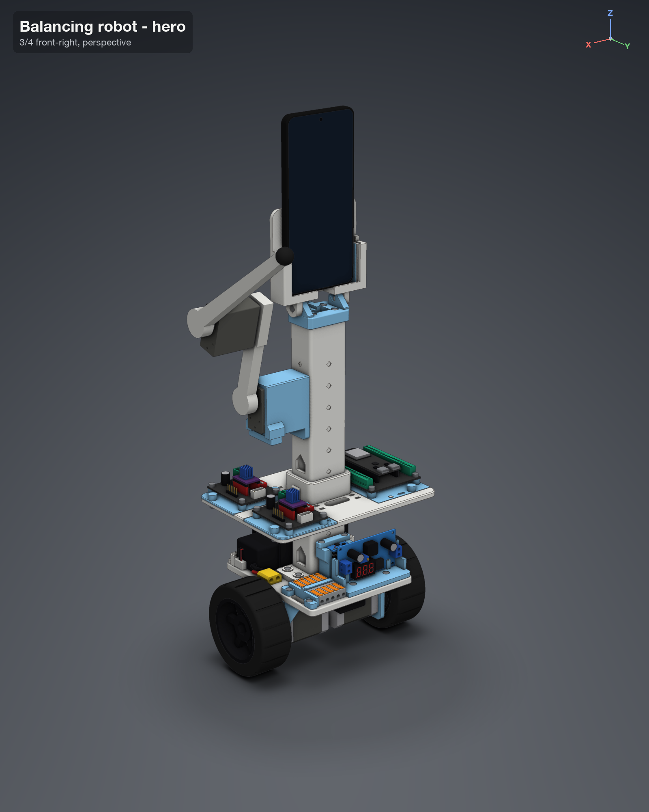

# Robot

The hardware is bought and 3D printed, and John is assembling it. This file covers what the parts mean for the product, the technical facts software needs, and what's still missing.

## Design

| Part | What it means for the product |
| --- | --- |
| 2 NEMA 17 steppers, 85 mm rubber wheels | Smooth indoor floors; precise slow moves; fine for a short demo area, not carpet or ramps |
| ESP32-S3 + MPU-6050 | Balancing runs on the robot itself |
| 3S 2200 mAh LiPo x2 (about 24 Wh each) | Swap packs between runs; a 12 V desk supply tethers it while testing |
| 240 mm printed mast + phone cradle (70-81 mm wide phones) | 495 mm from floor to phone top, 2.21 kg, footprint 188 x 130 mm: about knee-to-thigh height, phone face on top, tilts back 0-20° |
| iPhone 18 Pro or similar | Camera, screen, mic, speaker; LiDAR |
| 3 HTD-45H bus servos + BusLinker | In the CAD, a two-link arm on the mast's right side that ends in a ball: no gripper. It can wave, point, push or tap. Any other end attachment can be added later |
| Printed kickstand | It rests leaning back 13.1° when idle or while the arm works; also the fallback "kickstand mode" |
| No extra sensors | Everything it perceives comes from the phone |

Product consequence: low jobs (carrying small things in a tray, interacting with seated people or kids, looking at the floor) fit the body. Grabbing anything needs an end attachment that isn't built yet.

## Technical facts

- **Mass:** 2.21 kg; center of mass 93 mm above the axle; balances at about a 1.3° lean.
- **Drive:** steppers at 1/16 microstepping on TMC2209 drivers, step/dir only.
- **ESP32-S3 pins:**

| Pin | Connects to |
| --- | --- |
| GPIO 8 / 9 | MPU-6050 SDA / SCL (I2C) |
| GPIO 4 / 5 | Left driver STEP / DIR |
| GPIO 6 / 7 | Right driver STEP / DIR |
| GPIO 15 | EN on both drivers (LOW = motors on) |
| GPIO 17 / 18 | Reserved for the BusLinker (arm) |

- **Power:** battery through a 15 A fuse; a buck converter gives the ESP32 5 V. Unplugging the XT60 is the off switch.
- **Spares:** a second ESP32, two extra drivers, a third stepper and two extra IMUs. Enough for a desk test rig without taking parts from the robot.

## Materials and setup still needed (confirm with John)

- [ ] M3 screws, heat-set inserts and battery straps (still to buy as of Nov 10)
- [ ] USB cable for the ESP32-S3; USB lead for the BusLinker (it has a USB port)
- [ ] A second camera for vision work while the spare iPhone is on the robot: a teammate's phone or an MLH Logitech webcam
- [ ] 12 V for the arm on the desk while the bench supply tethers the robot
- [ ] An LLM API key
- [ ] A phone hotspot for the robot link

## Images

- [Exploded view](assets/exploded.png)
- [Spec sheet](assets/spec-sheet.png)
- [Drawing](assets/drawing.png)

CAD files, STLs, the 3D viewer and the assembly guide are in `reference/john-pack/` (raw archive).
