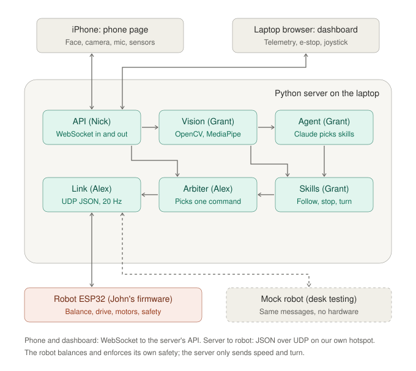
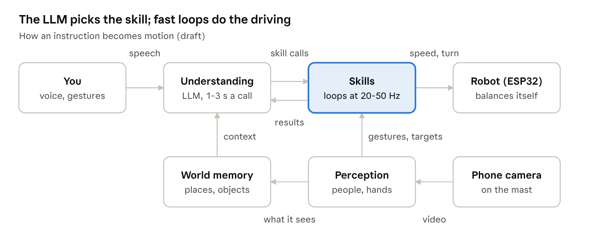

# Software

Draft. One Python server on the laptop is the hub: the phone and the dashboard feed it, and it steers the robot through one message contract. Items taken from John's or the teammate's briefs are inputs, not decisions, until they appear in `decisions/`.

## Architecture

- **The robot (ESP32, John's firmware)** balances itself 200 times a second and enforces its own safety (tilt cutoff, 300 ms command timeout), so a Wi-Fi hiccup can't topple it. It only takes speed and turn targets and a few named actions.
- **The phone** opens the phone page in Safari. It shows the face, sends camera frames, mic audio and motion sensors to the server, and plays Miguel's voice. (Web page or native app is still open: T-4.)
- **The Python server** runs everything else, in one process:

| Module | Owner | Job |
| --- | --- | --- |
| API | Nick | WebSocket for the phone page and the dashboard |
| Vision | Grant | Frames in, people and gestures out (OpenCV, MediaPipe) |
| Agent | Grant | Speech to text, then Claude picks a skill ("follow me" → `follow`) |
| Skills | Grant | Fast loops such as follow, stop and turn; each sends speed and turn targets |
| Arbiter | Alex | Picks one command: e-stop > manual joystick > skill |
| Link | Alex | JSON over UDP to the robot (or the mock), 20 times a second; telemetry back |

- **The dashboard** (a browser on the laptop) sends e-stop and joystick, and shows telemetry and what the robot sees.
- **The mock robot** speaks the same messages, so everything above runs unchanged on the desk.
- **Lag** matters only for the follow loop: camera to server to robot is about 100-250 ms on our own hotspot. John's follow tool works with ~0.2 s of video lag, so gentle gains handle it. The LLM (1-3 s) only picks skills, so it never steers.
- **Bench tools** in `firmware/balance/` (`drive.py`, `follow/`) talk to the robot directly over USB for testing and tuning. They aren't part of the product path.

## Code layout

| Folder | What | Stack |
| --- | --- | --- |
| `contract/` | Messages between laptop and robot, with samples | JSON |
| `firmware/` | Balancing, motors, IMU, robot link, arm; bench tools | ESP32, Arduino core 3.3.12 via arduino-cli |
| `server/` | Robot link, mock robot, vision, speech, LLM brain, skills, API for `web/` | Python |
| `web/` | Dashboard, plus the phone's face and camera page | Next.js |

- The server and the web app talk over a WebSocket: telemetry and what the robot sees go to the web app; e-stop, joystick and tasks come back.
- Safari only gives a web page camera access over HTTPS, so the phone page needs a certificate the phone trusts (for example `next dev --experimental-https`).
- The firmware builds with arduino-cli (see `firmware/README.md`), since it uses the ESP32 core 3.x timer API that PlatformIO's official platform doesn't ship (T-5).
- A balance simulation (`sim/`) is no longer needed: the robot balances.

## The contract (the seam)

Starting point, from John's brief: JSON over UDP, on a phone or laptop hotspot (not venue Wi-Fi). **What the robot actually speaks today is in `firmware/README.md`** ("The link it speaks today"); it differs from this draft in places (C-1, T-6). `contract/` will hold the agreed version, with samples captured from the robot.

- **Laptop to robot, 20-50 times a second:** `{"t":"cmd","v":0.3,"w":0.0,"mode":"drive"}`. `v` = forward speed (m/s), `w` = turn rate (rad/s), `mode` = idle | balance | drive | kickstand.
- **Robot to laptop, about 50 times a second:** `{"t":"tel","pitch":1.2,"rate":-0.4,"vl":0.28,"vr":0.31,"batt":11.6,"state":"balance","fault":null}`.
- **Arm:** add one message, for example a named pose ("wave").
- **Safety on the robot:** if no command arrives for 300 ms, it holds position; past a set tilt angle, it cuts the motors.
- **E-stop:** zero speed and turn while it keeps balancing; "motors off" (mode idle) is separate (decision 0043).
- **Mock robot:** a small laptop script that speaks the same messages and fakes the replies.

## Motion: balance and drive (on the ESP32)

- Balancing runs entirely on the robot; the laptop only says how fast to go and turn.
- Steppers mean the robot always knows its wheel speed, without encoders.
- **Status (Sat noon):** it balances hands-off with the phone mounted, drives up to 0.6 m/s, does exact 90° turns and 50 cm moves on the gyro, and parks on the kickstand. Details, tuned values and safety rules: `firmware/README.md`.
- **How:** a 200 Hz loop estimates tilt (complementary filter on the MPU-6050) and sets wheel acceleration from tilt, tilt rate, speed and position (gains from an LQR design on the CAD numbers, tuned on the robot). A 40 kHz timer sends the step pulses.
- **Still to add:** JSON commands for start, park and exact turns and moves; park at the 5-minute run limit instead of tipping over; kickstand mode (the fallback); battery reading; the arm. See C-5 to C-12 in `open-questions.md`.

## Arm

- The HTD-45H servos talk through the BusLinker board. On the desk, drive it straight from the laptop (USB port to confirm) and build named poses.
- On the moving robot no cable can reach the laptop, so the ESP32 drives the BusLinker (GPIO 17/18) and the laptop just sends pose names.
- No gripper in the CAD, so poses are wave, point, push and tuck.

## Vision and understanding (critical path)

- **Camera:** the phone page streams camera frames to the server and draws the face at the same time (Continuity Camera can't, because it takes over the phone's screen). Vision develops on a desk camera behind a frame-source interface until the phone page is ready. How video travels (T-10) and web page vs native app (T-4) are still open.
- **Voice:** the phone's mic and speaker, through the phone page (T-13), with push-to-talk on the dashboard as a backup.
- **Perception:** person tracking and hand gestures (MediaPipe) run on every frame on the laptop. Heavier scene and object understanding uses a vision-language model on demand, a few seconds per call.
- **Understanding:** speech to text, then an LLM that picks from a small set of robot skills. Gestures skip the LLM, so stop is instant.
- **Follow-me:** the person's position and size in the frame become turn rate and speed, with limits, a dead zone and smoothing. If the person is lost, stop and search slowly. John's follow tool already works on the robot: reuse its gains, dead zones and upper-body tracking (the camera sits ~40 cm up). They're listed under "Next, by lane" in `firmware/README.md`.
- **Testing without the robot:** hold the phone and walk around; the commands show on the panel and the mock.

## How an instruction becomes motion

The LLM is too slow (1-3 s a call) to steer, so it never drives the wheels. It turns a request into a short list of skill calls; each skill is plain code that runs a fast loop until it succeeds or fails, then reports back. Example: "Miguel, go to the chair and wave" becomes `go_to("chair")`, then `arm_pose("wave")`, then `say("Hi!")`. Gestures such as stop skip the LLM entirely.

- **Skills (draft list):** `follow(person)`, `stop()`, `go_to(target)`, `turn(degrees)`, `look_for(object)`, `describe_scene()`, `say(text)`, `arm_pose(name)`, `remember_place(name)`, `recall(question)`.
- **Three kinds of position:** where something is in the image (pixels); where it is relative to Miguel.exe (angle and rough distance, from the pixels and the camera's field of view); and where things are in the room (x, y, heading from the start point, counted from wheel steps).
- **Most skills need no map:** follow and go_to steer by keeping the target centered in the image and stop when it looks big enough. Only named places ("go to the kitchen") need room coordinates.
- **Room coordinates drift:** wheel counting slips, especially while balancing, so it's good for a few meters in a demo. Fixes if needed: markers (QR or AprilTags) on the floor or walls, or iPhone ARKit tracking (needs a native iOS app).
- **World memory:** a small store on the laptop, kept while Miguel.exe runs and wiped on restart: where it saw objects, named places, who is around, its own position, the current task. Perception and the `remember_place` skill write to it; a short text summary of it goes into every LLM call.
- **LLM calls:** an LLM has no memory of its own. Every call resends the instructions, the recent conversation and the memory summary. Keep only the last few exchanges, and keep old images as short text descriptions, so calls stay fast and cheap.

### Three lifetimes (draft)

| Lifetime | Starts | Ends | What it keeps |
| --- | --- | --- | --- |
| Robot run | Miguel.exe is switched on | Switched off or restarted | World memory |
| Conversation | Someone starts talking to it | About 2 minutes of silence, or a different person takes over | The last few exchanges, so "it" and "that one" make sense |
| Task (agent session) | A request that needs action ("go to the chair and wave") | Done, failed, stopped by gesture or e-stop, or replaced by a new request | The LLM's back-and-forth with its skill results for this one task |

Only one task runs at a time, since there's one body. Small talk ("how are you?") is a single LLM call with no task. Perception never uses an LLM call; it runs continuously and writes to world memory.

### Reality check

"A slow LLM picks from a set of skills, fast code runs them" is the standard pattern for LLM-controlled robots (research systems such as SayCan and Inner Monologue; commercial humanoids use the same slow-thinker/fast-controller split). The hard part is the skills themselves (vision that works in a noisy hall, a balancing robot that drives where it's told), not the LLM.

- **Decide now:** only the principle: the LLM picks skills and never drives; gestures skip it.
- **Decided:** world memory is in the build (decision 0039); Claude is the LLM, with Gemini swappable (0037).
- **Decide later:** conversation timeouts, named places and the exact skill list.
- **Start simple:** each request is one LLM call returning skill calls; add the memory summary once the store exists.
