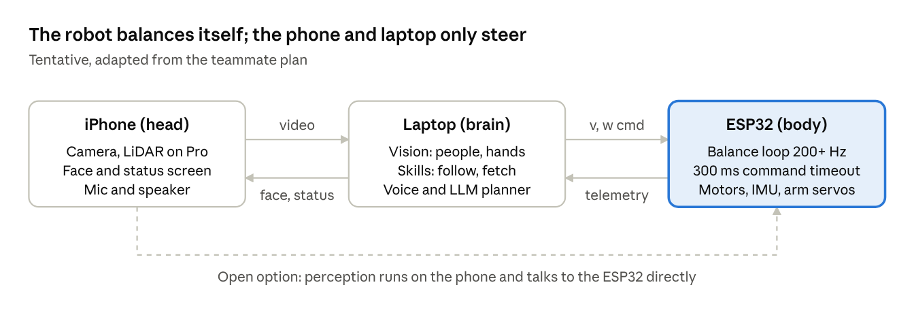

# Software

Draft. Three parts (motion, arm, vision and understanding) joined by one message contract. Items taken from John's or the teammate's briefs are inputs, not decisions, until they appear in `decisions/`.

## Architecture

The fast, safety-critical balance loop stays on the ESP32, so a Wi-Fi hiccup can't topple the robot; everything software owns only sends speed and turn targets. Where perception and planning run (laptop or phone) is still open.

## Code layout

| Folder | What | Stack |
| --- | --- | --- |
| `contract/` | Messages between laptop and robot, with samples | JSON |
| `firmware/` | Balancing, motors, IMU, robot link, arm | ESP32, PlatformIO (Arduino framework) |
| `server/` | Robot link, mock robot, vision, speech, LLM brain, skills, API for `web/` | Python |
| `web/` | Dashboard, plus the phone's face and camera page | Next.js |
| `sim/` | Balance simulation | Python |

- The server and the web app talk over a WebSocket: telemetry and what the robot sees go to the web app; e-stop, joystick and tasks come back.
- Safari only gives a web page camera access over HTTPS, so the phone page needs a certificate the phone trusts (for example `next dev --experimental-https`).
- PlatformIO pins library versions in one file and builds from the command line, so agents can build and upload. Its ESP32 support lags the newest Arduino core, so pin a version that works with FastAccelStepper.

## The contract (the seam)

Starting point, from John's brief: newline-delimited JSON over UDP, on a phone or laptop hotspot (not venue Wi-Fi).

- **Laptop to robot, 20-50 times a second:** `{"t":"cmd","v":0.3,"w":0.0,"mode":"drive"}`. `v` = forward speed (m/s), `w` = turn rate (rad/s), `mode` = idle | balance | drive | kickstand.
- **Robot to laptop, about 50 times a second:** `{"t":"tel","pitch":1.2,"rate":-0.4,"vl":0.28,"vr":0.31,"batt":11.6,"state":"balance","fault":null}`.
- **Arm:** add one message, for example a named pose ("wave").
- **Safety on the robot:** if no command arrives for 300 ms, it holds position; past a set tilt angle, it cuts the motors.
- **Mock robot:** a small laptop script that speaks the same messages and fakes the replies.

## Motion: balance and drive (on the ESP32)

- Balancing runs entirely on the robot; the laptop only says how fast to go and turn.
- Steppers mean the robot always knows its wheel speed, without encoders.
- Bench order: step pulses spin a loose motor; the IMU reads tilt correctly; the controller is tuned in a simple simulation using the CAD numbers (2.21 kg, center of mass 93 mm above the axle, 85 mm wheels); tethered balance on the robot; then driving.
- Kickstand mode: the same commands, no balancing. It's the fallback if balancing isn't reliable by T+18.
- Most balancing work can happen without the robot: a simulation for the controller and ballpark gains, plus a desk rig built from the spare parts for step timing, the IMU filter, loop timing, the link and safety. Only the final gain tuning needs the assembled robot, with a person at it.

## Arm

- The HTD-45H servos talk through the BusLinker board. On the desk, drive it straight from the laptop (USB port to confirm) and build named poses.
- On the moving robot no cable can reach the laptop, so the ESP32 drives the BusLinker (GPIO 17/18) and the laptop just sends pose names.
- No gripper in the CAD, so poses are wave, point, push and tuck.

## Vision and understanding (critical path)

- **Camera:** the phone streams to the laptop. The quickest start is Continuity Camera (the iPhone as a Mac webcam), but it takes over the phone's screen, so no face. A web page in Safari on the phone can stream the camera and draw the face at the same time. Proposal: start vision on Continuity Camera, build the web page in parallel, switch when it works.
- **Perception:** person tracking and hand gestures (MediaPipe) run on every frame on the laptop. Heavier scene and object understanding uses a vision-language model on demand, a few seconds per call.
- **Understanding:** speech to text, then an LLM that picks from a small set of robot skills. Gestures skip the LLM, so stop is instant.
- **Follow-me:** the person's position and size in the frame become turn rate and speed, with limits, a dead zone and smoothing. If the person is lost, stop and search slowly.
- **Testing without the robot:** hold the phone and walk around; the commands show on the panel and the mock.

## How an instruction becomes motion

The LLM is too slow (1-3 s a call) to steer, so it never drives the wheels. It turns a request into a short list of skill calls; each skill is plain code that runs a fast loop until it succeeds or fails, then reports back. Example: "Miguel, go to the chair and wave" becomes `go_to("chair")`, then `arm_pose("wave")`, then `say("Hi!")`. Gestures such as stop skip the LLM entirely.

- **Skills (draft list):** `follow(person)`, `stop()`, `go_to(target)`, `turn(degrees)`, `look_for(object)`, `describe_scene()`, `say(text)`, `arm_pose(name)`, `remember_place(name)`, `recall(question)`.
- **Three kinds of position:** where something is in the image (pixels); where it is relative to Miguel.exe (angle and rough distance, from the pixels and the camera's field of view); and where things are in the room (x, y, heading from the start point, counted from wheel steps).
- **Most skills need no map:** follow and go_to steer by keeping the target centered in the image and stop when it looks big enough. Only named places ("go to the kitchen") need room coordinates.
- **Room coordinates drift:** wheel counting slips, especially while balancing, so it's good for a few meters in a demo. Fixes if needed: markers (QR or AprilTags) on the floor or walls, or iPhone ARKit tracking (needs a native iOS app).
- **World memory:** a small store on the laptop, kept while Miguel.exe runs and wiped on restart: where it saw objects, named places, who is around, its own position, the current task. Perception and the `remember_place` skill write to it; a short text summary of it goes into every LLM call.
- **LLM calls:** an LLM has no memory of its own. Every call resends the instructions, the recent conversation and the memory summary. Keep only the last few exchanges, and keep old images as short text descriptions, so calls stay fast and cheap.

### Three lifetimes (draft)

| Lifetime | Starts | Ends | What it keeps |
| --- | --- | --- | --- |
| Robot run | Miguel.exe is switched on | Switched off or restarted | World memory |
| Conversation | Someone starts talking to it | About 2 minutes of silence, or a different person takes over | The last few exchanges, so "it" and "that one" make sense |
| Task (agent session) | A request that needs action ("go to the chair and wave") | Done, failed, stopped by gesture or e-stop, or replaced by a new request | The LLM's back-and-forth with its skill results for this one task |

Only one task runs at a time, since there's one body. Small talk ("how are you?") is a single LLM call with no task. Perception never uses an LLM call; it runs continuously and writes to world memory.

### Reality check

"A slow LLM picks from a set of skills, fast code runs them" is the standard pattern for LLM-controlled robots (research systems such as SayCan and Inner Monologue; commercial humanoids use the same slow-thinker/fast-controller split). The hard part is the skills themselves (vision that works in a noisy hall, a balancing robot that drives where it's told), not the LLM.

- **Decide now:** only the principle: the LLM picks skills and never drives; gestures skip it.
- **Decide later:** memory, conversation timeouts, named places and the exact skill list.
- **Start simple:** each request is one LLM call returning skill calls, with no stored memory.
