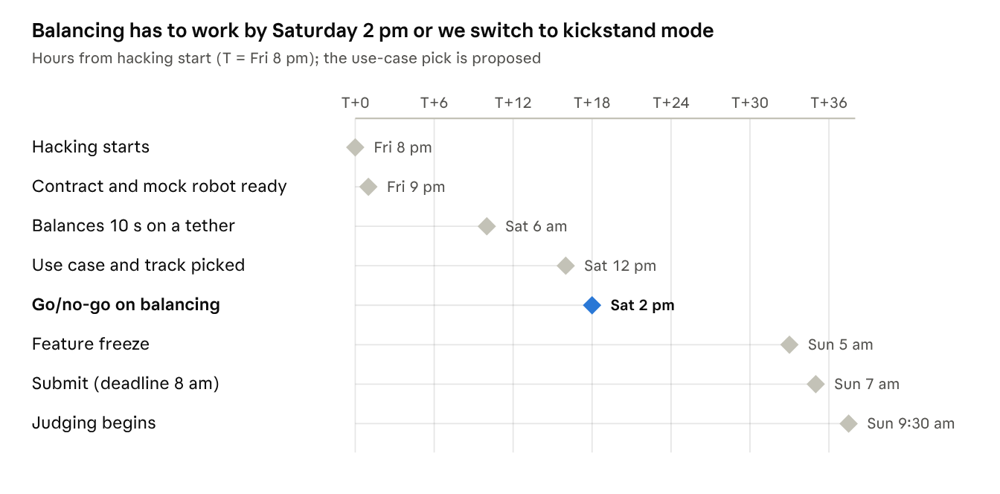

# Milestones

The checkpoints for the weekend. Tasks themselves live in GitHub Issues. Only the master agent edits this file. T = hacking start, Fri 8 pm ET; timing is approximate.

| When | Milestone | Done when |
| --- | --- | --- |
| T+1 (Fri 9 pm) | Contract and mock robot | Messages and samples in `contract/`; the mock robot accepts commands and sends fake telemetry. Overdue |
| Sat 6 pm (was T+8, Sat 4 am) | First end-to-end slice | A person walks in front of the phone, the server decides, the mock robot follows; then the real robot over Wi-Fi. Missed at 4 am; moved |
| T+10 (Sat 6 am) | Tethered balance | The robot balances 10 s on a tether. Met: it balances hands-off with the phone on (Sat noon) |
| T+16 (Sat 12 pm) | Use case and main track picked | Recorded in `decisions/`. Use case picked Sat 2:30 pm (0052); main track still open |
| T+18 (Sat 2 pm) | Go/no-go on balancing | Balances and drives by joystick; otherwise demo in kickstand mode. Effectively go: it balances and drives from the keyboard |
| T+33 (Sun 5 am) | Feature freeze | Bug fixes only after this |
| T+35 (Sun 7 am) | Submit | Submitted on Devpost, an hour before the 8 am deadline |
| Sun 9:30 am | Judging | In-person demo, max 2 min |

## Before submission

- [ ] Make the repo public
- [ ] Devpost: disclose AI tool use and the pre-event hardware work
- [ ] README.md credits every open-source library
- [ ] Backup demo video (optional, max 2 min)
- [ ] Rehearse the demo path
